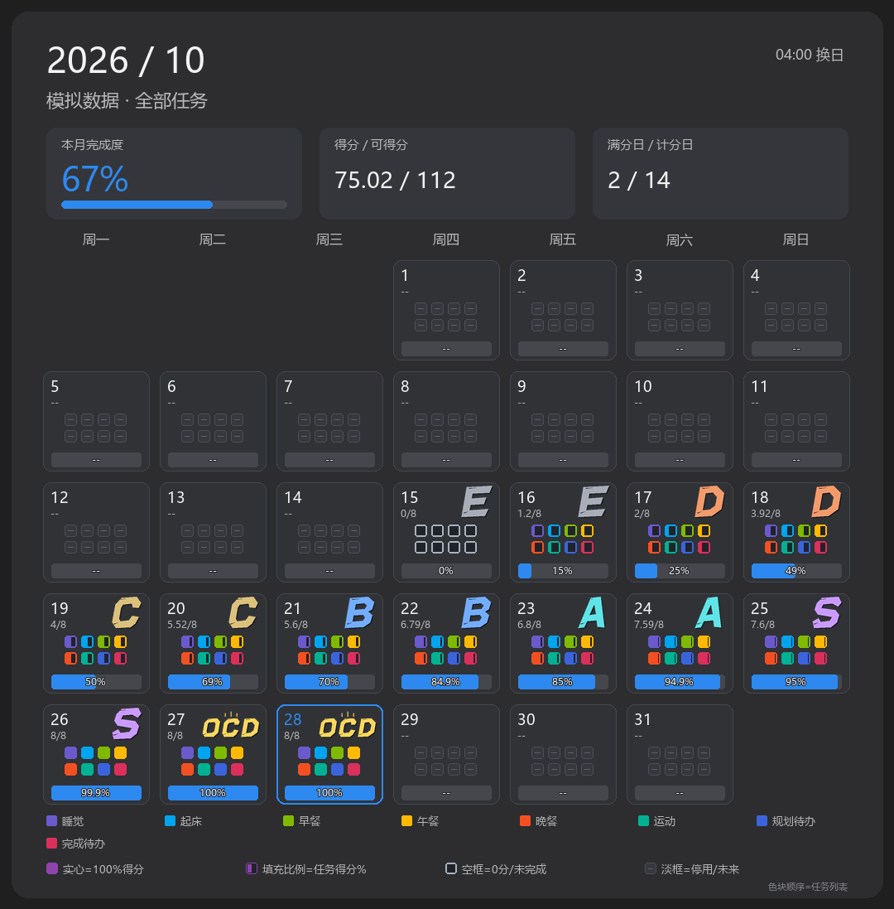
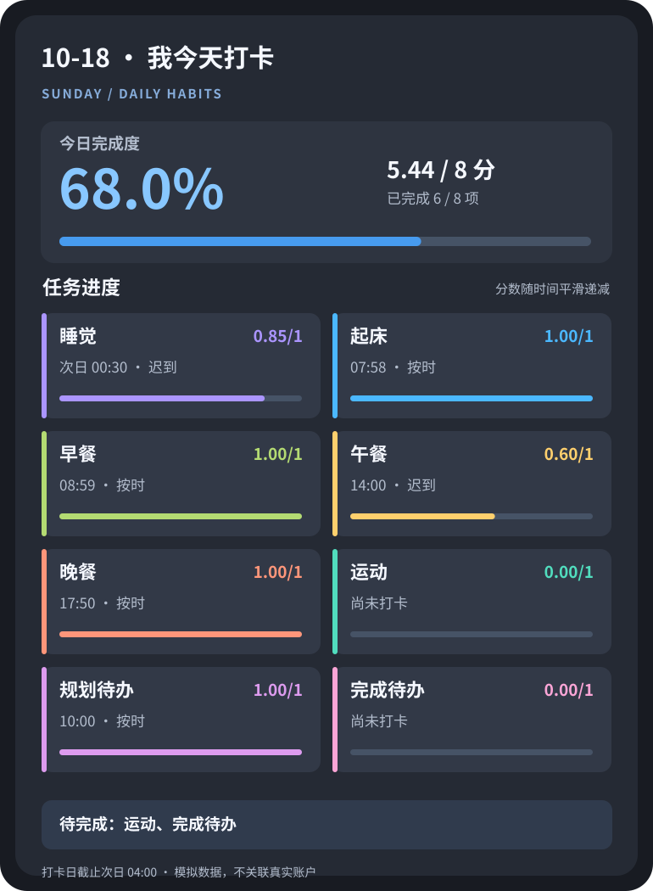

<div align="center">
  <h1>🌱 AstrBot 习惯打卡</h1>
  <p><strong>把生活过成看得见的进步。</strong></p>
  <p>个人习惯 · 温和计分 · 每日进度 · 多彩月历 · QQ 快捷打卡</p>
  <p><code>v1.9.6</code> · <code>AstrBot ≥ 4.17</code> · <code>SQLite</code> · <code>04:00 换日</code></p>
</div>

> **v1.9.6 重点：**历史日期、当日与未来日期**全部统一使用温和衰减公式**，打开旧月历即可看到重算得分；新增**可自定义的任务排序**，每日视图、快捷按钮与历史月历同步。**原始打卡记录不变。**

## ✨ 界面预览

<p align="center">
  
  &nbsp;&nbsp;
  
</p>

<p align="center"><sub>左：月历视图　·　右：每日打卡视图</sub></p>

**这是使用模拟数据绘制的 SVG 文档示例**，并非真实用户记录，也不是 QQ 消息截图。插件运行时的图片由 Pillow 渲染为 PNG；这两张轻量 SVG 仅用于 README 预览，点击可查看原图。

## 💎 功能亮点

- **每天更有方向：**新账户初始化 8 项常见习惯；每天凌晨 **04:00** 切换打卡日，午夜后的「睡觉」仍算前一个打卡日。
- **更公平的时间计分：**准时满分，迟到缓降；每次打卡有独立得分，既鼓励守时，也不过分惩罚迟到。
- **一眼看懂进度：**每日得分/完成次数与进度条；月历按每项任务实际得分比例上色，半填不是随便填一半。
- **自定义显示顺序：**一条命令移动某项任务，或一次性重排任务；每日、月历和 QQ 快捷按钮均采用同一顺序。
- **在 QQ 中直接使用：**个人打卡、任务编辑、补签、记录查询、图片/文字视图和可用时的快捷按钮。
- **个人记录与管理权限分离：**用户整理自己的任务；AstrBot 管理员可查询用户并通过确认流程处理跨用户操作。
- **数据在自己手中：**使用本地 SQLite，保留按日期版本化的目标、权重、最佳时间设置，以及历史事件和升级备份。

## 📐 统一温和衰减计分 v1.9.6

准时或提前完成时，时间得分系数是 **100%**；迟到后，使用新的平滑曲线：

$$
\boxed{f(t)=\left(1+\frac{t\ln 2}{H}\right)2^{-t/H}}
$$

其中：

- **\(t\)**：超出最佳时间的分钟数，即 `max(0, 实际完成时间 − 最佳时间)`；未迟到时直接计 100%。
- **\(H\)**：衰减尺度，单位分钟。默认限时任务 **H = 60**；数值越大，衰减越慢。
- **\(f(t)\)**：本次打卡得到的满分比例，介于 0% 和 100% 之间。

### 旧公式与新公式对比

| 迟到时间 | 旧版 \(2^{-t/H}\) | 新版平滑衰减 |
|:--|--:|--:|
| 准时 | 100% | 100% |
| 0.5H | 70.7% | **95.2%** |
| 1H | 50% | **84.7%** |
| 2H | 25% | **59.7%** |
| 3H | 12.5% | **38.5%** |

例如，**睡觉最佳时间 23:30，H = 60 分钟**：23:45 得 **98.7%**；次日 00:30 得 **84.7%**；次日 01:30 得 **59.7%**。午夜前后的归属按打卡日确定。

> **命名兼容提示：**旧版把参数 H 称为「半衰期」，因为旧公式经过 H 分钟恰好剩 50%。新公式在 H 时约剩 **84.7%**，所以 **H 不再是严格的半衰期**。为了兼容旧数据，仍保留 `delay_minutes` 存储字段，但历史日期不再使用旧公式；设置请使用正式命令 `/打卡 任务 时间 睡觉 23:30 60`（旧版独立的「半衰期／延迟」命令不再是有效入口）。界面与文档将其称作「衰减尺度 H」。

**任务与总体得分怎么算？** 对于每日目标 \(n\) 次、权重 \(w\) 的任务：

$$
\text{任务得分}=w\,\frac{\sum_{i=1}^{\min(k,n)} f(t_i)}{n},
\qquad
\text{当日完成度}=\frac{\sum\text{任务得分}}{\sum\text{有效权重}}
$$

其中 \(k\) 为已计入的打卡次数。超过目标次数不额外加分；不限时任务每次计 100%；权重为 **0** 的任务仍可打卡，但不参与总完成度分母。月历总完成度采用已计分日期的**总得分 ÷ 总可得分**，不是把每天的百分比简单平均。

**历史统一计分：**从 v1.9.6 起，**任意年份、任意月份、任意打卡日**都使用上面的**同一条公式**。首次运行时将数据库里的历史计分模型标识统一为 `smooth_decay`；日视图、月历总分、按任务月历和好友月度排行均在查询时按新规则重新计算，**无需清除缓存或重打卡**。

保留各历史日期原有的**目标次数、权重、最佳时间、衰减尺度 H** 和真实打卡时间，不会用今天的时间配置覆盖过去的配置；只统一*计分函数*。旧数据如果没有真实完成时间，程序不会编造时间或追溯扣除迟到分数，而是保留“时间未知”提示。升级前会备份 SQLite；原始 `records` / `checkin_events` 不删除、不改写。**历史分数和月完成度可能增加；这是新公式的预期效果。**

## 🌤 默认的 8 项习惯

新注册账户使用以下模板。所有任务默认 **每天 1 次、权重 1、启用**。

| 习惯 | 最佳时间 | 缓降尺度 H |
|:--|:--:|--:|
| 🌙 睡觉 | 23:30 | 60 分钟 |
| 🌅 起床 | 08:00 | 60 分钟 |
| 🥣 早餐 | 09:00 | 60 分钟 |
| 🍱 午餐 | 12:00 | 60 分钟 |
| 🍽 晚餐 | 18:00 | 60 分钟 |
| 🏃 运动 | 不限时 | 不扣时间分 |
| 📝 规划待办 | 10:00 | 60 分钟 |
| 🎯 完成待办 | 22:00 | 60 分钟 |

已有用户的自定义任务**不会因升级自动重置**；如需要把旧用户统一为这套模板，请先阅读下文的「旧数据迁移」章节。

## 🚀 开始使用

在 QQ 向机器人发送这些命令即可：

```text
/打卡                      # 看今天的进度
/打卡 起床                 # 给「起床」打卡一次
/打卡 月历                 # 看本月得分月历
/打卡 任务                 # 查看习惯与计分参数
/打卡 任务 目标 阅读 2       # 新建或修改目标次数
/打卡 任务 时间 睡觉 23:30 60 # 最佳时间与衰减尺度 H
/打卡 任务 权重 阅读 0       # 设为不计分的可选任务
/打卡 任务 排序             # 查看当前显示顺序
/打卡 任务 排序 运动 2       # 将运动移到第 2 位
/打卡 记录 昨天             # 查询昨天的记录
/打卡 视图 今日 图片         # 选择每日图片视图
/打卡 视图 月历 图片         # 选择月历图片视图
/打卡 帮助                 # 图片或文字版完整帮助
```

一天中对同一习惯可以多次打卡（最多计入任务目标次数）；补签需使用真实完成时间并受补签天数限制。停用任务保留历史记录，和「彻底删除」是不同操作。

### ↕️ 自定义任务顺序

```text
/打卡 任务 排序
/打卡 任务 排序 运动 2
/打卡 任务 排序 睡觉 起床 运动 早餐 午餐 晚餐 规划待办 完成待办
```

- **查看顺序：**单独发送 `/打卡 任务 排序`，显示每项任务的序号（含停用任务）。
- **移动单项：**`/打卡 任务 排序 运动 2` 将「运动」移到第 2 位，其余顺延；位置从 **1** 开始，不能超出任务总数。
- **批量指定：**按列出的顺序排列指定任务，**未列出的任务按原顺序追加**。若有任务已停用，仍会保留在排序列表中。

**只更改当前账户的显示顺序**：每日文字/图片、QQ 快捷按钮和所有历史月历的任务色块按新顺序显示；不会改变已得分数、任务目标、权重、最佳时间或历史事件，也不会影响其他用户。月历中的任务颜色基于任务名称固定，不会因排序而变色。

<details>
<summary><b>📚 展开完整命令表（每日、月历、任务、记录、视图、好友、账户、群管理及调试）</b></summary>

```text
🌱 打卡命令大全 · v1.9.6
每次打卡仅增加 1 次；每日 04:00 换日。

【日常打卡】
/打卡
  查看今日打卡进度
/打卡 睡觉
  为「睡觉」打卡一次
/打卡 月历
  查看本月全部习惯的完成情况
/打卡 月历 睡觉 2026-10
  查看指定习惯及月份

【任务管理】
/打卡 任务
  查看目标、计分配置和停用状态
/打卡 任务 目标 阅读 2
  新建／修改／恢复，设为每天 2 次
/打卡 任务 删除 阅读
  停用目标，但保留历史记录
/打卡 任务 时间 睡觉 23:30 60
  最佳时间 23:30，缓降尺度 H=60 分钟
/打卡 任务 时间 运动 关闭
  关闭该目标的时间扣分
/打卡 任务 权重 阅读 0
  权重为 0，不计入总分
/打卡 任务 排序
  查看当前任务显示顺序（包括停用项）
/打卡 任务 排序 运动 2
  将运动移到第二位，其余顺延
/打卡 任务 排序 睡觉 起床 运动 早餐 午餐 晚餐
  批量指定前几项顺序，其余任务按原顺序追加
/打卡 任务 规则
  查看完整计分规则

【打卡记录】
/打卡 记录
  查看今天的所有打卡记录
/打卡 记录 睡觉
  查看今天「睡觉」的记录
/打卡 记录 昨天
  查看昨天的全部记录
/打卡 记录 睡觉 2026-10-18
  查看指定日期的单项记录
/打卡 记录 补签 睡觉 昨天 23:50
  按真实完成时间补签一次
/打卡 记录 清除 睡觉 [日期]
  清除这一天的全部睡觉记录；默认今天

【个人视图】
/打卡 视图
  查看我的全部默认视图设置
/打卡 视图 今日 图片
  每日进度默认显示图片
/打卡 视图 今日 文字
  每日进度默认显示文字
/打卡 视图 月历 图片
  月历默认显示图片
/打卡 视图 月历 文字
  月历默认显示文字
/打卡 视图 帮助 图片
  帮助默认发送本张命令图片
/打卡 视图 帮助 文字
  帮助默认发送纯文字清单
/打卡 视图 操作 自动
  自动选择快捷操作样式
/打卡 视图 操作 按钮
  优先使用 QQ 按钮
/打卡 视图 操作 文字链接
  使用文字链接快捷操作
/打卡 视图 操作 关闭
  不展示快捷操作
/打卡 视图 重置
  重置个人视图为插件默认
/打卡 视图 诊断
  查看发送方式与错误信息

【好友功能】
/打卡 好友 月历 小明
  查看同群好友的公开月历
/打卡 好友 排行 [月份]
  查看群排行榜；月份可省略
/打卡 好友 隐私 隐藏
  退出排行并隐藏好友查询
/打卡 好友 隐私 公开
  重新开放好友查询与排行

【账户管理】
/打卡 账户
  查看账户及身份绑定信息
/打卡 账户 绑定
  在私聊中获取绑定码
/打卡 账户 绑定 绑定码
  在群聊输入真实的 16 位绑定码
/打卡 账户 解绑
  取消私聊的默认群关联

【群管理】
/打卡 群设置 提醒 21:30
  设置群内每日提醒时间
/打卡 群设置 提醒 关闭
  关闭群内每日提醒

【调试工具】
/打卡 调试
  查看调试命令说明
/打卡 调试 用户列表
  管理员分页查看账户ID、群昵称、SID/OpenID/UIN 等平台标识
/打卡 调试 用户 账户ID 更名 阅读 读书
  管理员处理指定用户的任务
/打卡 调试 用户 账户ID 彻底删除 阅读
  管理员彻底删除指定用户的任务
/打卡 调试 删除用户 账户ID
  管理员预览删除用户账户、任务和记录
/打卡 调试 更名 阅读 读书
  重命名；目标已存在则合并记录
/打卡 调试 更名 阅读 读书 确认 确认码
  预览后在 5 分钟内确认更名
/打卡 调试 彻底删除 阅读
  预览删除任务和全部历史记录
/打卡 调试 彻底删除 阅读 确认 确认码
  预览后在 5 分钟内确认永久删除

【帮助】
/打卡 帮助
  显示全部正式命令（图片或文字）

注：方括号表示可省略参数；示例中的习惯名、日期可以替换。
私聊／群聊的个人视图相同。旧命令不再作为入口。
```

</details>

## 🔐 权限与危险操作

| 功能 | 普通用户 | AstrBot 管理员 |
|:--|:--:|:--:|
| 打卡、修改或停用自己的任务 | ✅ | ✅ |
| 调试更名 / 合并 / 彻底删除自己的任务与记录 | ✅ | ✅ |
| 查看其他账户 ID、昵称、SID / OpenID 等标识 | ❌ | ✅ |
| 管理其他用户的任务 | ❌ | ✅ |
| 删除整个用户账户 | ❌ | ✅（不得删除当前操作者自身） |

这里的管理员是 **AstrBot 配置的管理员**，不是 QQ 群管理员。危险的彻底删除或更名/合并采用**先预览影响、再使用 5 分钟内的确认码执行**的方式，并在操作前创建数据库备份。删除在线数据库中的记录不会自动擦除已有备份文件。

## 🛠 安装与升级（Debian + Docker）

插件要求 **AstrBot ≥ 4.17.0**，使用 SQLite 存储数据。图像功能需要 `Pillow>=10`，建议容器安装 Noto Sans CJK 中文字体，否则可能回退为文字视图。

**方式 A：GitHub 仓库管理（推荐）**。在服务器已将插件仓库检出到 `/opt/services/astrbot/data/plugins/astrbot_plugin_daka` 且工作区干净时：

```bash
cd /opt/services/astrbot/data/plugins/astrbot_plugin_daka
git status
git pull --ff-only origin main
# 确认新源码无误后重启
docker restart astrbot
docker logs --since 3m --tail=150 astrbot
```

`main` 和目录名仅为示例；以实际分支、插件安装目录和容器名称为准。**不要为了更新源码而卸载旧插件**：卸载可能连带清理 `plugin_data`。

**方式 B：使用 ZIP 安全更新器。** 旧版本 `update_source.py` 只接受它对应的旧版本 ZIP，不能直接拿来安装新版本。请从新 ZIP 单独提取新更新脚本，并先运行 `--check-only`：

```bash
cd /opt/services/astrbot
unzip -p /path/to/astrbot_plugin_daka_v1.9.6.zip astrbot_plugin_daka/update_source.py > /tmp/daka-update-v196.py
python3 /tmp/daka-update-v196.py /path/to/astrbot_plugin_daka_v1.9.6.zip --check-only
python3 /tmp/daka-update-v196.py /path/to/astrbot_plugin_daka_v1.9.6.zip
docker logs --since 3m --tail=150 astrbot
```

运行前请将 `/path/to/...` 替换成实际 ZIP 路径，并核查更新脚本的预览输出。这个更新器会备份源代码和数据目录，但**不会清空 SQLite**。此外，v1.9.6 **第一次升级**会在统一历史计分模型前通过 SQLite backup API 创建 `backups/astrbot_plugin_daka/pre-1.9.6-*.sqlite3` 快照。

### 升级后验证

```text
/打卡 任务
/打卡 任务 规则
/打卡 任务 排序
/打卡
/打卡 月历
/打卡 月历 2026-10
/打卡 视图 今日 图片
/打卡 视图 月历 图片
```

观察 `H=60` 对应的说明是否是「约 84.7%」，而不再是「降至 50%」；**打开升级前某个月份**，查看迟到任务得分是否按新公式变化；然后调整一次任务排序，确认同一月历上的色块位置同步变化。请在自己的 AstrBot / QQ 客户端验证实际渲染、权限与交互。

<details>
<summary><b>🗂 旧用户一次性默认任务迁移（会删除「工作一小时」的历史，谨慎展开）</b></summary>

升级到 v1.9.6 并不会自动把所有旧账户改为八项默认任务。如果你**明确希望**给旧账户批量套用新模板，可使用仓库内 `migrate_defaults_v193.py`。它会删除各账户中「工作一小时」相关任务、规则和历史记录；对「早睡」「早起」进行谨慎更名；其他自定义任务尽量保留，只调整默认项排序。**这不是升级计分公式的必要步骤。**

```bash
# 默认只预览数据库变更
python3 /opt/services/astrbot/data/plugins/astrbot_plugin_daka/migrate_defaults_v193.py \
  --db /opt/services/astrbot/data/plugin_data/astrbot_plugin_daka/checkin.sqlite3

# 只有核对预览和备份后才实际迁移
python3 /opt/services/astrbot/data/plugins/astrbot_plugin_daka/migrate_defaults_v193.py \
  --db /opt/services/astrbot/data/plugin_data/astrbot_plugin_daka/checkin.sqlite3 --apply

docker restart astrbot
```

迁移脚本会额外生成 SQLite 一致性备份。如果你的数据库路径不同，请相应替换 `--db`。操作前建议停止相关写入，并保留完整数据目录备份。

</details>

## ❓ 常见问题

**为什么完成了任务，进度条却不是满的？**
完成次数与得分是两个不同概念：某项任务即使打卡次数达标，迟到仍可能只得到 84.7% 等部分得分。每日总完成度和月历小方块都显示真实得分，而不是单看次数。

**运动之类不限时任务怎么算？**
不设最佳时间，不会因完成时间被扣分。把权重设为 0，则只记录习惯，不参与总完成度。

**升级后旧月历会立刻重新计分吗？**
会。从 v1.9.6 起，旧月历和新月历都统一使用温和平滑衰减公式，查询时直接计算，不依赖固定的月度得分缓存。不过，历史日期仍沿用当日保存的最佳时间和权重；如果该日期没有发生迟到、缺少完成时间或原本没有限时规则，升级前后分数可能相同。

**任务排序会影响历史分数吗？**
不会。排序只影响各界面的排列与月历任务格子位置，不改变任何一条打卡记录和计分权重。

**能在 QQ 中撤销彻底删除吗？**
不能通过聊天直接撤销。删除前会备份数据，但手工恢复备份可能覆盖后来产生的新记录，应先谨慎核对。

## 🧭 版本记录

- **v1.9.6** — 历史/当日/未来统一温和公式；自动备份与全历史计分模型迁移；新增任务移动/批量排序并同步每日、月历及快捷按钮。
- **v1.9.5** — 引入温和平滑衰减公式（当时仅升级当前日）；更新 SVG 示例和 README。
- **v1.9.4** — 月历按实际得分比例填充方格；任务方格多行放大；强化总完成度进度条、未完成/未来状态区分。
- **v1.9.3** — 八项默认任务与用户调试、管理员账户管理、旧默认数据迁移脚本。
- **v1.9.0–1.9.2** — 统一命令、图片帮助、QQ 快捷打卡及个人视图偏好。

---

<sub>本插件用于自主习惯记录，完成时间由用户自行申报。QQ 图片及按钮能否展示，以客户端和所授予的官方接口权限为准；离线测试不代表真实平台部署已验证。</sub>
